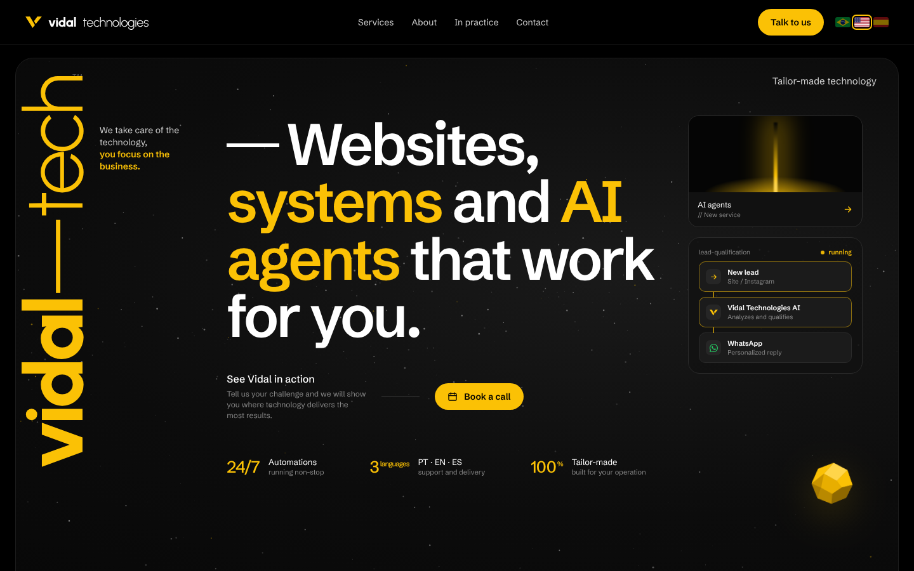
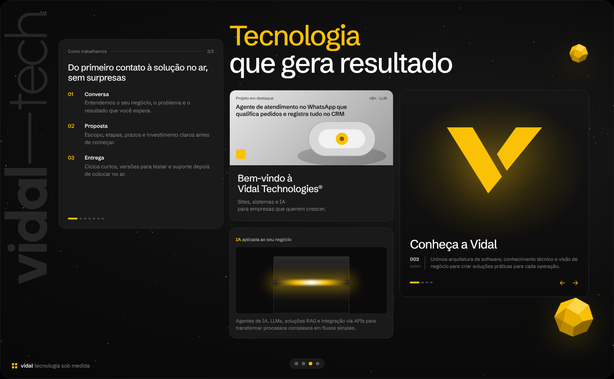
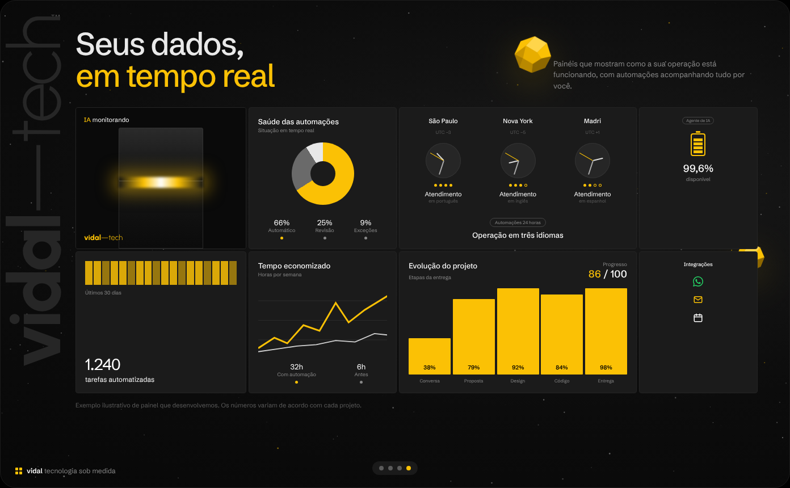
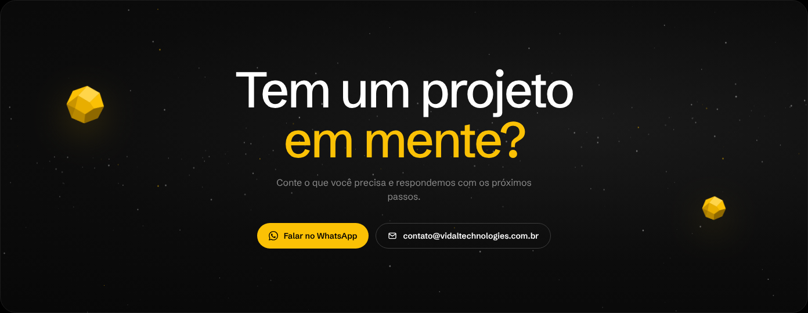
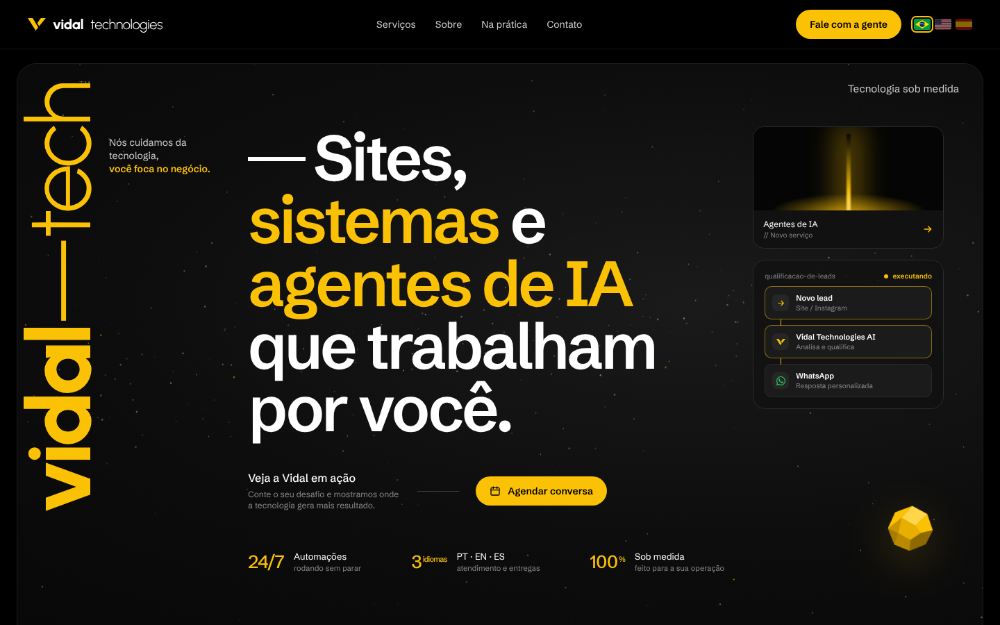
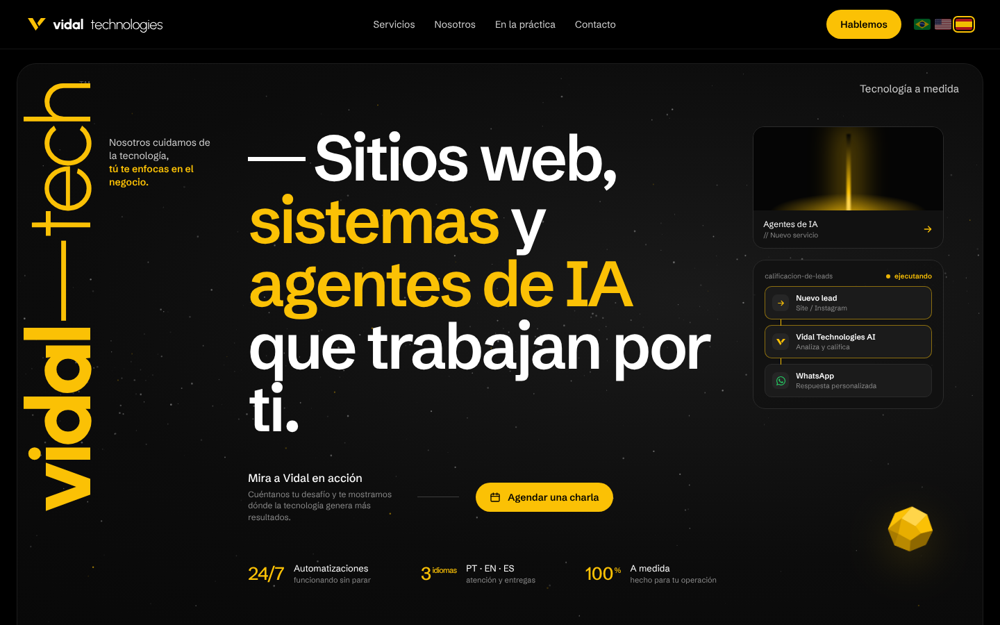
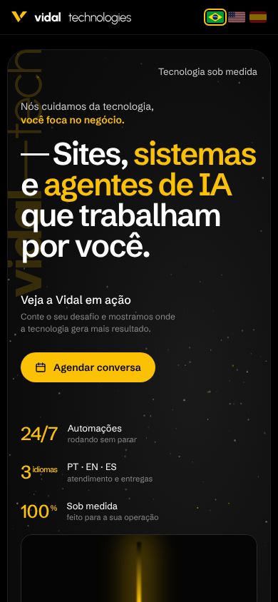
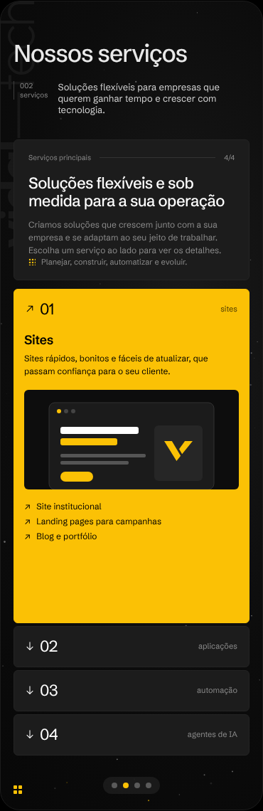

<p align="center">
  
</p>

<h1 align="center">Vidal Technologies — landing page</h1>

<p align="center">
  Landing page for <strong>Vidal Technologies</strong>, a company that builds websites, systems, automations and AI agents for businesses.<br />
  Available in Portuguese, English and Spanish.
</p>

<p align="center">
  <a href="README.md">Português</a> · <strong>English</strong> · <a href="README.es.md">Español</a>
</p>

<p align="center">
  
  
  
  
  
</p>



## About the project

This repository holds the Vidal Technologies landing page, a single page built for
campaigns and for the first contact with new clients. It presents the services, shows how
the company works and leads visitors to get in touch via WhatsApp or e-mail.

The page is built with plain HTML, CSS and JavaScript in a single file, with no libraries
and no build step. The code is open and is part of the company's portfolio.

### Goals

- Present the company in a visual, direct way, organized in modules.
- Show the services and an example of a dashboard the company builds.
- Serve clients in Brazil and abroad, with the content in three languages.
- Lead visitors to contact with a single click.

## Features

- **Three languages:** Portuguese, English and Spanish, switched with the flags in the top
  right corner. The choice is saved and can also come in the address (`?lang=en` or `?lang=es`).
- **Hero:** title with gold highlights, animated particle background, key figures and a
  mini automation flow.
- **Services:** cards numbered 01 to 04 (Websites, Web applications, Process automation and
  AI agents) that open on click and rotate on their own.
- **About:** how we work (Conversation, Proposal and Delivery), a featured project and the "Meet Vidal" card.
- **Dashboard:** an illustrative dashboard with animated charts and live clocks for
  São Paulo, New York and Madrid.
- **Contact:** WhatsApp button, with a ready-made message in the chosen language, and e-mail button.
- **Responsive:** layout designed for desktop and mobile.
- **Own visual identity:** black background, graphite tones and gold `#FBC105`,
  Schibsted Grotesk font and an SVG logo.

## Screens

### Desktop

| Services | About |
| --- | --- |
|  |  |

| Dashboard | Contact |
| --- | --- |
|  |  |

### Other languages

| Portuguese (default) | Spanish (`?lang=es`) |
| --- | --- |
|  |  |

### Mobile

| Hero | Services | Contact |
| --- | --- | --- |
|  |  |  |

## Technologies

| Technology | What it is used for |
| --- | --- |
| HTML5 | Page structure and content |
| CSS3 | Styles, bento grid layout, animations and mobile version |
| JavaScript | Language switching, particle background (Canvas), service cards, clocks and scroll animations |
| SVG | Logo, icons, flags and illustrations |
| [Google Fonts](https://fonts.google.com/) | Schibsted Grotesk and Urbanist fonts |

The page uses no database, frameworks or external libraries. Everything lives in a single
`index.html`, which keeps the page light, fast and easy to host.

## Running it locally

Just open `index.html` in your browser. If you prefer a local server:

```bash
git clone https://github.com/vidaltechnologies/vidaltechnologies-lp.git
cd vidaltechnologies-lp
python3 -m http.server 8000
```

Then open http://localhost:8000. The English and Spanish versions are at
http://localhost:8000/?lang=en and http://localhost:8000/?lang=es.

## Code structure

```
index.html          # Full page: HTML, CSS, JavaScript and the texts in all three languages
docs/
├── icon.svg        # Icon used in this README
└── screenshots/    # Images used in this README
```

---

© Vidal Technologies. All rights reserved.
