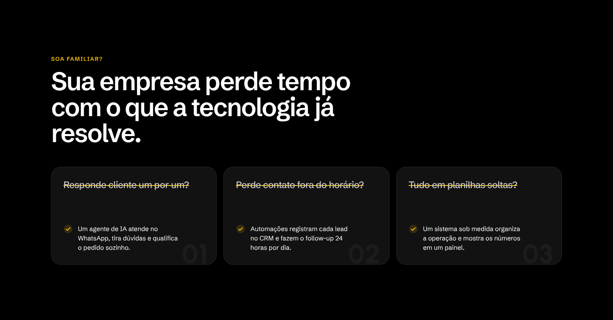
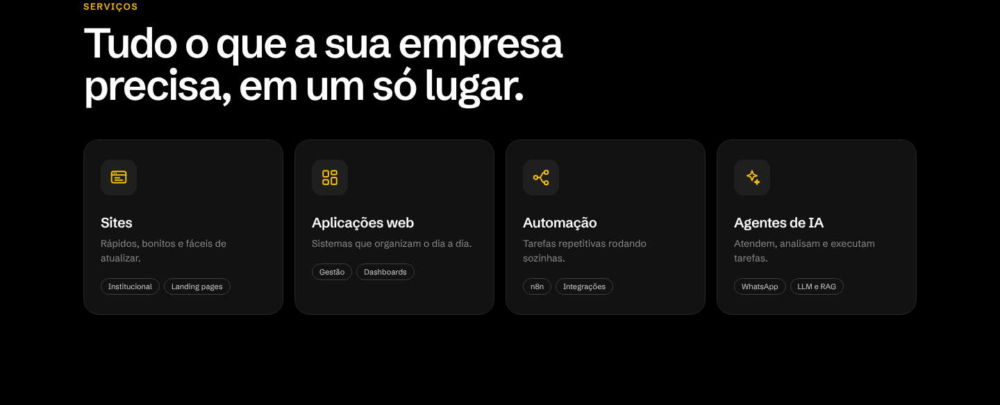

<p align="center">
  
</p>

<h1 align="center">Vidal Technologies — landing page</h1>

<p align="center">
  Landing page for <strong>Vidal Technologies</strong>, a company that builds websites, systems, automations and AI agents for businesses.<br />
  Available in Portuguese, English and Spanish.
</p>

<p align="center">
  <a href="README.md">Português</a> · <strong>English</strong> · <a href="README.es.md">Español</a>
</p>

<p align="center">
  
  
  
  
  
</p>


## About the project

This repository holds the Vidal Technologies landing page, a single page built for
campaigns and for the first contact with new clients. It presents the problems it
solves and the services, and leads visitors straight to WhatsApp or e-mail.

The page is built with plain HTML, CSS and JavaScript in a single file, with no libraries
and no build step. The code is open and is part of the company's portfolio.

### Goals

- Present the company in a visual, direct way, organized in modules.
- Show the problems technology solves and the services, without excess text.
- Serve clients in Brazil and abroad, with the content in three languages.
- Lead visitors to contact with a single click.

## Features

- **Three languages:** Portuguese, English and Spanish, switched with the flags in the top
  right corner. The choice is saved and can also come in the address (`?lang=en` or `?lang=es`).
- **Hero:** title with a rotating word ("Technology that *serves* / *sells* / *organizes*
  for you"), animated particle background and the WhatsApp button.
- **Animated chat:** a phone shows an AI agent serving a customer on WhatsApp, message by message.
- **Word strip:** the services scrolling in a loop.
- **Problems and solutions:** three common pains that get crossed out as you scroll, followed
  by the solution.
- **Services:** Websites, Web applications, Automation and AI agents in short cards, with a
  gold glow that follows the mouse.
- **Final call and floating WhatsApp:** a gold contact block and a WhatsApp button always
  visible in the corner, with a ready-made message in the chosen language.
- **Responsive:** layout designed for desktop and mobile.
- **Own visual identity:** black background, graphite tones and gold `#FBC105`,
  Schibsted Grotesk font and an SVG logo.

## Screens

### Desktop

| Problems and solutions | Services |
| --- | --- |
|  |  |

| Final call | |
| --- | --- |
|  | |

### Other languages

| Portuguese (default) | Spanish (`?lang=es`) |
| --- | --- |
|  |  |

### Mobile

| Hero | Animated chat | Final call |
| --- | --- | --- |
|  |  |  |

## Technologies

| Technology | What it is used for |
| --- | --- |
| HTML5 | Page structure and content |
| CSS3 | Styles, layout, animations and mobile version |
| JavaScript | Language switching, rotating word, animated chat, particle background (Canvas) and scroll animations |
| SVG | Logo, icons, flags and illustrations |
| [Google Fonts](https://fonts.google.com/) | Schibsted Grotesk and Urbanist fonts |

The page uses no database, frameworks or external libraries. Everything lives in a single
`index.html`, which keeps the page light, fast and easy to host.

## Running it locally

Just open `index.html` in your browser. If you prefer a local server:

```bash
git clone https://github.com/vidaltechnologies/vidaltechnologies-lp.git
cd vidaltechnologies-lp
python3 -m http.server 8000
```

Then open http://localhost:8000. The English and Spanish versions are at
http://localhost:8000/?lang=en and http://localhost:8000/?lang=es.

## Code structure

```
index.html          # Full page: HTML, CSS, JavaScript and the texts in all three languages
docs/
├── icon.svg        # Icon used in this README
└── screenshots/    # Images used in this README
```

---

© Vidal Technologies. All rights reserved.
