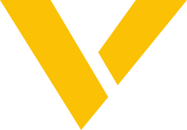
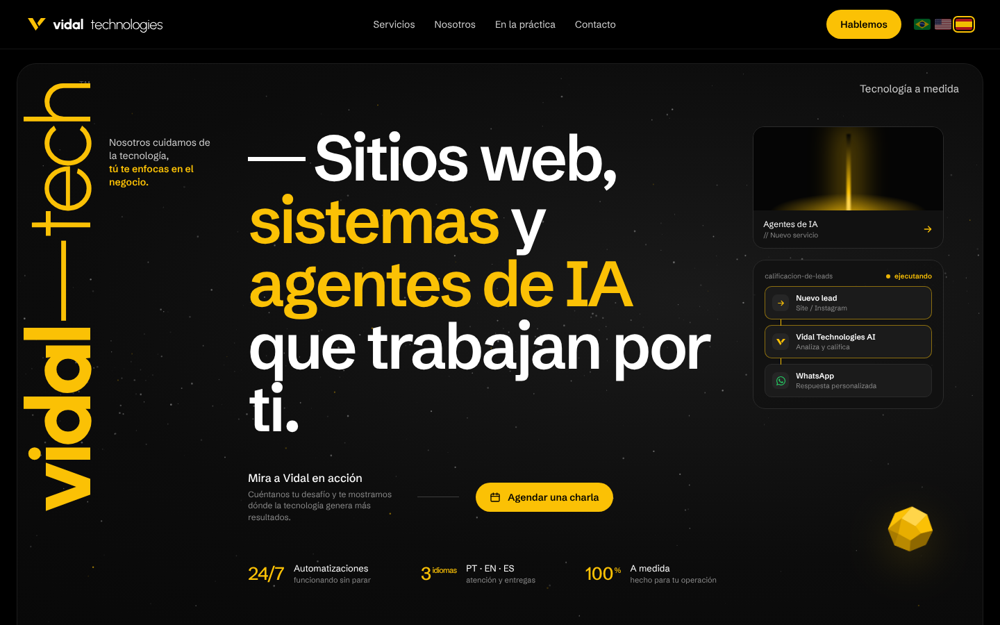
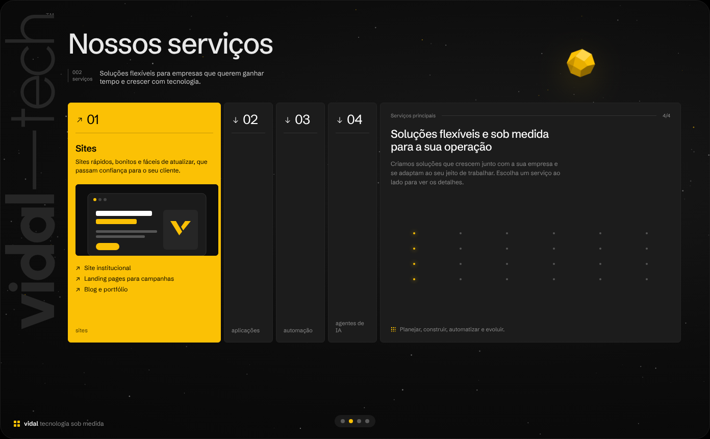
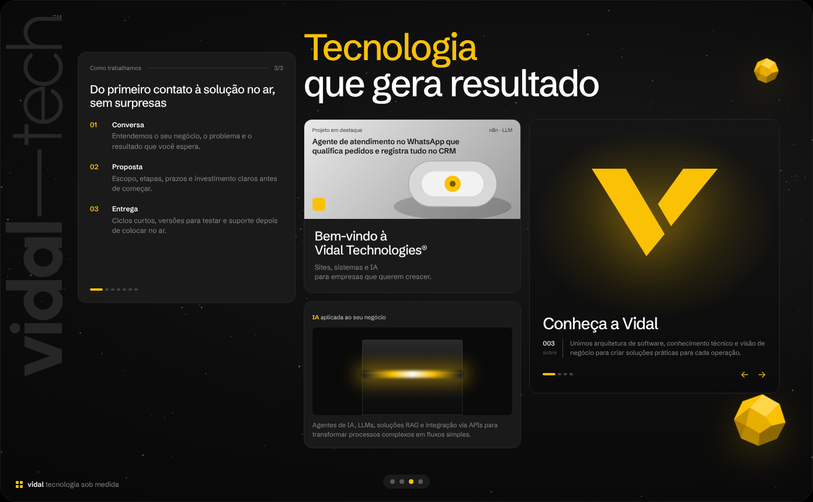
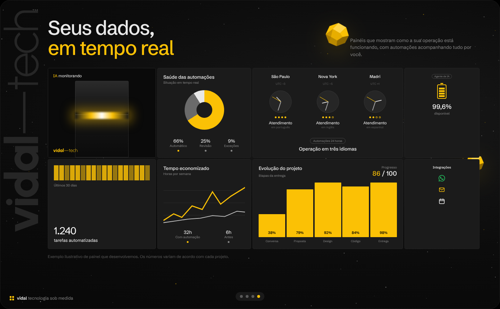
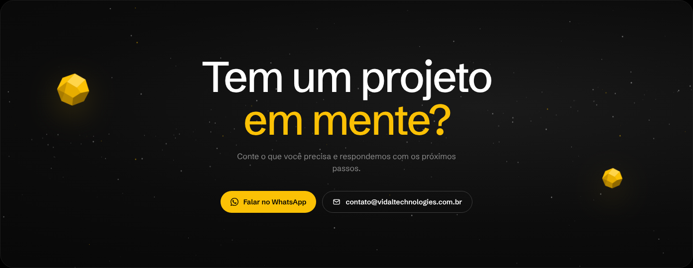
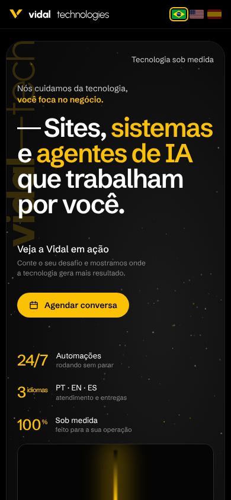
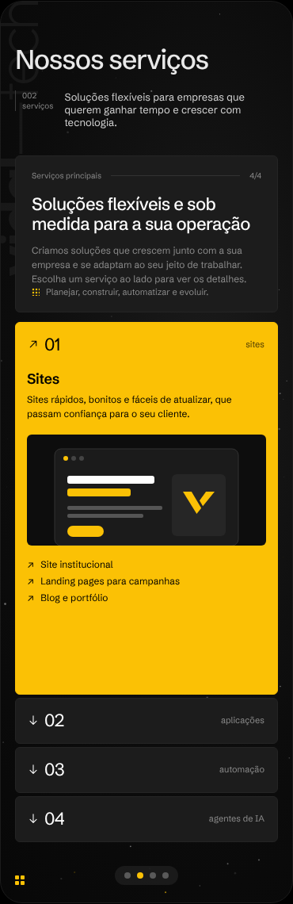

<p align="center">
  
</p>

<h1 align="center">Vidal Technologies — landing page</h1>

<p align="center">
  Landing page de <strong>Vidal Technologies</strong>, empresa que crea sitios web, sistemas, automatizaciones y agentes de IA para empresas.<br />
  Disponible en portugués, inglés y español.
</p>

<p align="center">
  <a href="README.md">Português</a> · <a href="README.en.md">English</a> · <strong>Español</strong>
</p>

<p align="center">
  
  
  
  
  
</p>



## Sobre el proyecto

Este repositorio contiene la landing page de Vidal Technologies, una página única pensada
para campañas y para el primer contacto con nuevos clientes. Presenta los servicios,
muestra cómo trabaja la empresa y lleva al visitante a escribir por WhatsApp o por e-mail.

La página está hecha con HTML, CSS y JavaScript puros, en un único archivo, sin librerías
y sin etapa de build. El código es abierto y forma parte del portafolio de la empresa.

### Objetivos

- Presentar la empresa de forma visual y directa, en módulos.
- Mostrar los servicios y un ejemplo de panel que la empresa desarrolla.
- Atender clientes en Brasil y en el exterior, con el contenido en tres idiomas.
- Llevar al visitante al contacto con un clic.

## Funcionalidades

- **Tres idiomas:** portugués, inglés y español, con cambio por banderas en la esquina
  superior derecha. La elección queda guardada y también puede venir en la dirección (`?lang=en` o `?lang=es`).
- **Inicio:** título con destacados en dorado, fondo de partículas animado, cifras y un
  mini flujo de automatización.
- **Servicios:** tarjetas numeradas del 01 al 04 (Sitios web, Aplicaciones web, Automatización
  de procesos y Agentes de IA), que se abren al hacer clic y cambian solas.
- **Nosotros:** cómo trabajamos (Conversación, Propuesta y Entrega), un proyecto destacado y la tarjeta "Conoce a Vidal".
- **Panel:** ejemplo ilustrativo de dashboard, con gráficos animados y relojes en vivo de
  São Paulo, Nueva York y Madrid.
- **Contacto:** botón de WhatsApp, con mensaje listo en el idioma elegido, y botón de e-mail.
- **Responsivo:** diseño pensado para computadora y celular.
- **Identidad visual propia:** fondo negro, tonos grafito y dorado `#FBC105`, fuente
  Schibsted Grotesk y logo dibujado en SVG.

## Pantallas

### Computadora

| Servicios | Nosotros |
| --- | --- |
|  |  |

| Panel | Contacto |
| --- | --- |
|  |  |

### Otros idiomas

| Portugués (predeterminado) | Inglés (`?lang=en`) |
| --- | --- |
|  |  |

### Celular

| Inicio | Servicios | Contacto |
| --- | --- | --- |
|  |  |  |

## Tecnologías

| Tecnología | Para qué sirve |
| --- | --- |
| HTML5 | Estructura y contenido de la página |
| CSS3 | Estilos, diseño en cuadrícula (bento), animaciones y versión para celular |
| JavaScript | Cambio de idioma, fondo de partículas (Canvas), tarjetas de servicios, relojes y animaciones al desplazarse |
| SVG | Logo, íconos, banderas e ilustraciones |
| [Google Fonts](https://fonts.google.com/) | Fuentes Schibsted Grotesk y Urbanist |

La página no usa base de datos, frameworks ni librerías externas. Todo está en un único
`index.html`, lo que hace la página liviana, rápida y fácil de alojar.

## Cómo ejecutarla en tu computadora

Basta con abrir el archivo `index.html` en el navegador. Si prefieres un servidor local:

```bash
git clone https://github.com/vidaltechnologies/vidaltechnologies-lp.git
cd vidaltechnologies-lp
python3 -m http.server 8000
```

Después, abre http://localhost:8000. Las versiones en inglés y español están en
http://localhost:8000/?lang=en y http://localhost:8000/?lang=es.

## Estructura del código

```
index.html          # Página completa: HTML, CSS, JavaScript y los textos en los tres idiomas
docs/
├── icon.svg        # Ícono usado en este README
└── screenshots/    # Imágenes usadas en este README
```

---

© Vidal Technologies. Todos los derechos reservados.
