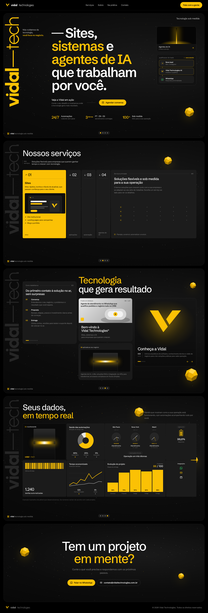

# Vidal Technologies | Landing page

Landing page da [Vidal Technologies](https://vidaltechnologies.com.br): sites, aplicações web, automações e agentes de IA sob medida.

É uma página única, em HTML, CSS e JavaScript puros, sem dependências e sem etapa de build. Basta abrir o `index.html` no navegador.

## Seções

1. **Início:** título, chamada para conversa, números e um mini fluxo de automação.
2. **Serviços:** cartões 01 a 04 (Sites, Aplicações web, Automação de processos, Agentes de IA), que se abrem ao clicar e trocam sozinhos.
3. **Sobre:** como trabalhamos, projeto em destaque e "Conheça a Vidal".
4. **Painel:** exemplo ilustrativo de dashboard, com gráficos e relógios ao vivo.
5. **Contato:** WhatsApp e e-mail.

## Identidade visual

- Fundo preto e grafite, com dourado `#FBC105` de destaque
- Fonte Schibsted Grotesk e logo "vidal technologies" com o V dourado
- Botões arredondados, fundo de partículas animado e layout responsivo (computador e celular)

## Prévia

## Publicação

Envie o `index.html` para a pasta desejada na hospedagem (por exemplo `public_html/lp/` na Hostinger). A página abre direto, sem precisar de servidor especial.
