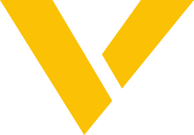
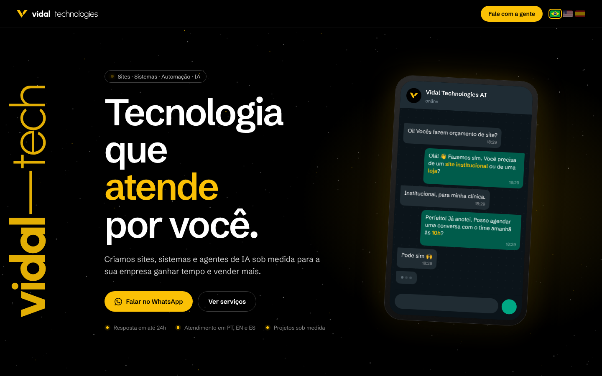
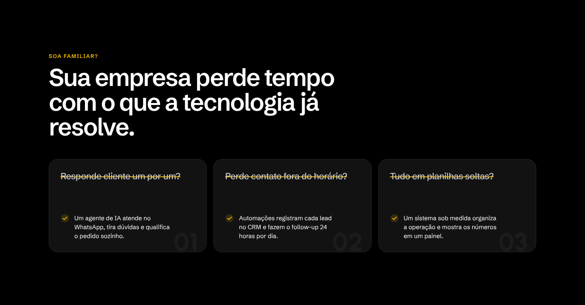
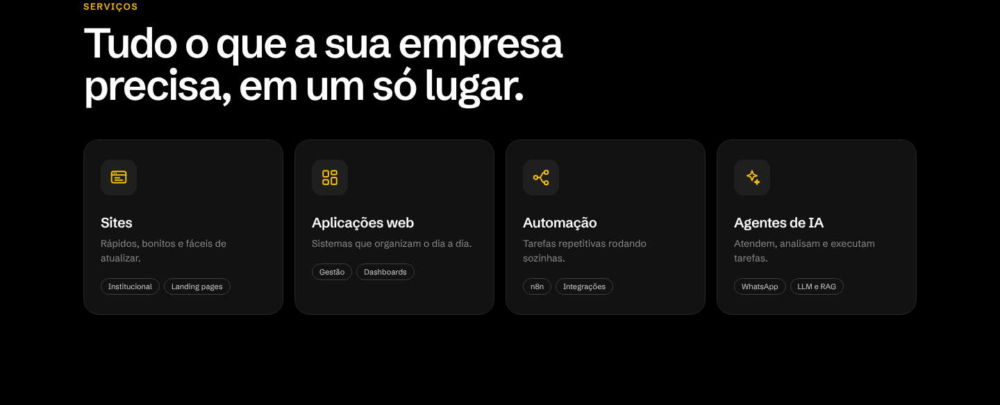
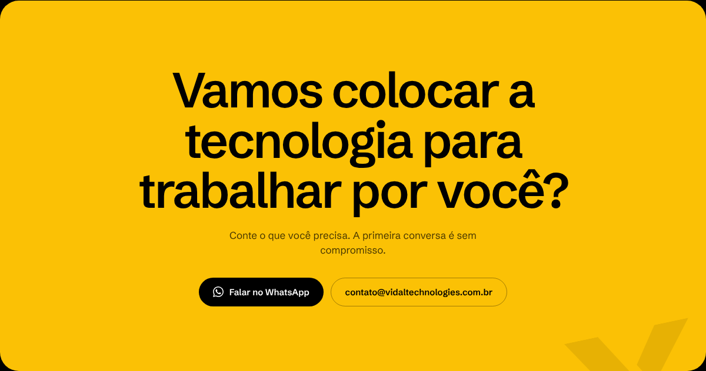
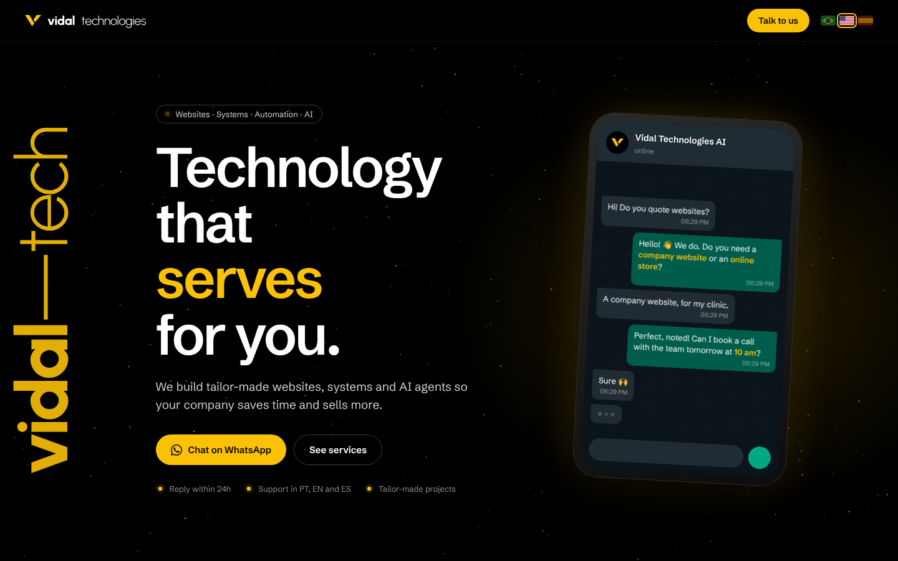
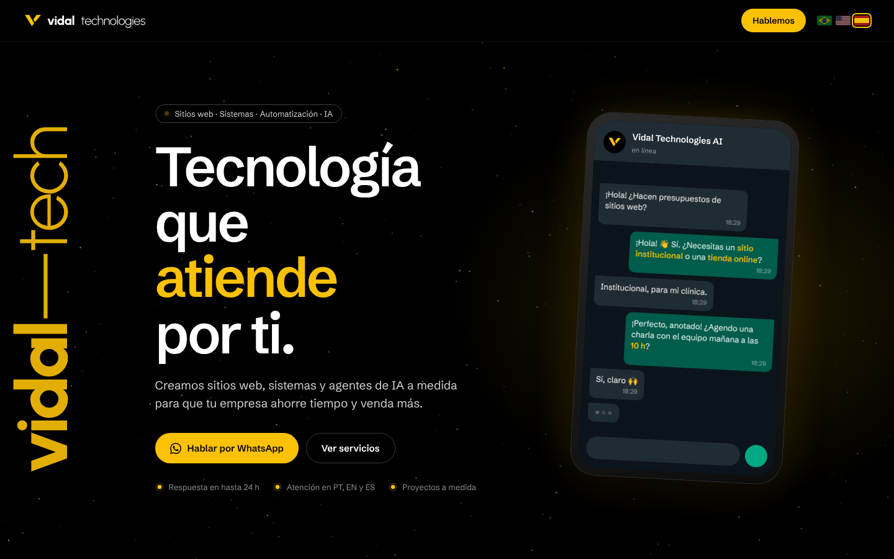
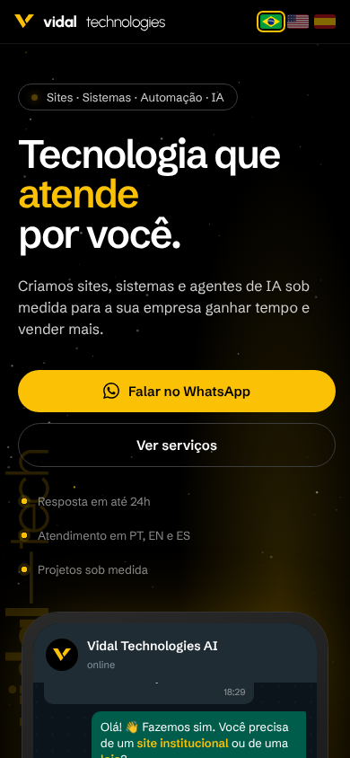

<p align="center">
  
</p>

<h1 align="center">Vidal Technologies — landing page</h1>

<p align="center">
  Landing page da <strong>Vidal Technologies</strong>, empresa que cria sites, sistemas, automações e agentes de IA para empresas.<br />
  Disponível em português, inglês e espanhol.
</p>

<p align="center">
  <strong>Português</strong> · <a href="README.en.md">English</a> · <a href="README.es.md">Español</a>
</p>

<p align="center">
  
  
  
  
  
</p>



## Sobre o projeto

Este repositório contém a landing page da Vidal Technologies, uma página única pensada
para campanhas e para o primeiro contato com novos clientes. Ela mostra os problemas que
resolve e os serviços, e leva o visitante direto ao WhatsApp ou ao e-mail.

A página é feita com HTML, CSS e JavaScript puros, em um único arquivo, sem bibliotecas
e sem etapa de build. O código é aberto e faz parte do portfólio da empresa.

### Objetivos

- Apresentar a empresa de forma visual e direta, em módulos.
- Mostrar os problemas que a tecnologia resolve e os serviços, sem excesso de texto.
- Atender clientes no Brasil e no exterior, com o conteúdo em três idiomas.
- Levar o visitante ao contato com um clique.

## Funcionalidades

- **Três idiomas:** português, inglês e espanhol, com troca por bandeiras no canto
  superior direito. A escolha fica salva e também pode vir no endereço (`?lang=en` ou `?lang=es`).
- **Topo:** título com uma palavra que gira sozinha ("Tecnologia que *atende* / *vende* /
  *organiza* por você"), fundo de partículas animado e o botão de WhatsApp.
- **Conversa animada:** um celular mostra um agente de IA atendendo um cliente no WhatsApp,
  mensagem por mensagem.
- **Faixa de palavras:** os serviços passando em loop, de um lado para o outro.
- **Problemas e soluções:** três dores comuns que são riscadas ao rolar a página, com a
  solução aparecendo em seguida.
- **Serviços:** Sites, Aplicações web, Automação e Agentes de IA em cartões curtos, com um
  brilho dourado que segue o mouse.
- **Chamada final e WhatsApp fixo:** bloco dourado com o contato e um botão de WhatsApp
  sempre visível no canto da tela, com mensagem pronta no idioma escolhido.
- **Responsivo:** layout pensado para computador e celular.
- **Identidade visual própria:** fundo preto, tons de grafite e dourado `#FBC105`, fonte
  Schibsted Grotesk e logo desenhada em SVG.

## Telas

### Computador

| Problemas e soluções | Serviços |
| --- | --- |
|  |  |

| Chamada final | |
| --- | --- |
|  | |

### Outros idiomas

| Inglês (`?lang=en`) | Espanhol (`?lang=es`) |
| --- | --- |
|  |  |

### Celular

| Início | Conversa animada | Chamada final |
| --- | --- | --- |
|  |  |  |

## Tecnologias

| Tecnologia | Para que serve |
| --- | --- |
| HTML5 | Estrutura e conteúdo da página |
| CSS3 | Estilos, layout, animações e versão para celular |
| JavaScript | Troca de idioma, palavra que gira, conversa animada, fundo de partículas (Canvas) e animações ao rolar |
| SVG | Logo, ícones, bandeiras e ilustrações |
| [Google Fonts](https://fonts.google.com/) | Fontes Schibsted Grotesk e Urbanist |

A página não usa banco de dados, frameworks nem bibliotecas externas. Tudo fica em um
único `index.html`, o que deixa a página leve, rápida e fácil de hospedar.

## Como rodar no seu computador

Basta abrir o arquivo `index.html` no navegador. Se preferir usar um servidor local:

```bash
git clone https://github.com/vidaltechnologies/vidaltechnologies-lp.git
cd vidaltechnologies-lp
python3 -m http.server 8000
```

Depois, abra http://localhost:8000. As versões em inglês e espanhol ficam em
http://localhost:8000/?lang=en e http://localhost:8000/?lang=es.

## Estrutura do código

```
index.html          # Página completa: HTML, CSS, JavaScript e os textos nos três idiomas
docs/
├── icon.svg        # Ícone usado neste README
└── screenshots/    # Imagens usadas neste README
```

---

© Vidal Technologies. Todos os direitos reservados.
