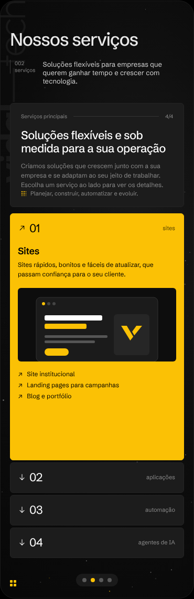

<p align="center">
  
</p>

<h1 align="center">Vidal Technologies — landing page</h1>

<p align="center">
  Landing page da <strong>Vidal Technologies</strong>, empresa que cria sites, sistemas, automações e agentes de IA para empresas.<br />
  Disponível em português, inglês e espanhol.
</p>

<p align="center">
  <strong>Português</strong> · <a href="README.en.md">English</a> · <a href="README.es.md">Español</a>
</p>

<p align="center">
  
  
  
  
  
</p>


## Sobre o projeto

Este repositório contém a landing page da Vidal Technologies, uma página única pensada
para campanhas e para o primeiro contato com novos clientes. Ela apresenta os serviços,
mostra como a empresa trabalha e leva o visitante a conversar pelo WhatsApp ou por e-mail.

A página é feita com HTML, CSS e JavaScript puros, em um único arquivo, sem bibliotecas
e sem etapa de build. O código é aberto e faz parte do portfólio da empresa.

### Objetivos

- Apresentar a empresa de forma visual e direta, em módulos.
- Mostrar os serviços e um exemplo de painel que a empresa desenvolve.
- Atender clientes no Brasil e no exterior, com o conteúdo em três idiomas.
- Levar o visitante ao contato com um clique.

## Funcionalidades

- **Três idiomas:** português, inglês e espanhol, com troca por bandeiras no canto
  superior direito. A escolha fica salva e também pode vir no endereço (`?lang=en` ou `?lang=es`).
- **Início:** título com destaques em dourado, fundo de partículas animado, números e um
  mini fluxo de automação.
- **Serviços:** cartões numerados de 01 a 04 (Sites, Aplicações web, Automação de processos e
  Agentes de IA), que se abrem ao clicar e trocam sozinhos.
- **Sobre:** como trabalhamos (Conversa, Proposta e Entrega), um projeto em destaque e o cartão "Conheça a Vidal".
- **Painel:** exemplo ilustrativo de dashboard, com gráficos animados e relógios ao vivo de
  São Paulo, Nova York e Madri.
- **Contato:** botões de WhatsApp, com mensagem pronta no idioma escolhido, e de e-mail.
- **Responsivo:** layout pensado para computador e celular.
- **Identidade visual própria:** fundo preto, tons de grafite e dourado `#FBC105`, fonte
  Schibsted Grotesk e logo desenhada em SVG.

## Telas

### Computador

| Serviços | Sobre |
| --- | --- |
|  |  |

| Painel | Contato |
| --- | --- |
|  |  |

### Outros idiomas

| Inglês (`?lang=en`) | Espanhol (`?lang=es`) |
| --- | --- |
|  |  |

### Celular

| Início | Serviços | Contato |
| --- | --- | --- |
|  |  |  |

## Tecnologias

| Tecnologia | Para que serve |
| --- | --- |
| HTML5 | Estrutura e conteúdo da página |
| CSS3 | Estilos, layout em grade (bento), animações e versão para celular |
| JavaScript | Troca de idioma, fundo de partículas (Canvas), cartões de serviço, relógios e animações ao rolar |
| SVG | Logo, ícones, bandeiras e ilustrações |
| [Google Fonts](https://fonts.google.com/) | Fontes Schibsted Grotesk e Urbanist |

A página não usa banco de dados, frameworks nem bibliotecas externas. Tudo fica em um
único `index.html`, o que deixa a página leve, rápida e fácil de hospedar.

## Como rodar no seu computador

Basta abrir o arquivo `index.html` no navegador. Se preferir usar um servidor local:

```bash
git clone https://github.com/vidaltechnologies/vidaltechnologies-lp.git
cd vidaltechnologies-lp
python3 -m http.server 8000
```

Depois, abra http://localhost:8000. As versões em inglês e espanhol ficam em
http://localhost:8000/?lang=en e http://localhost:8000/?lang=es.

## Estrutura do código

```
index.html          # Página completa: HTML, CSS, JavaScript e os textos nos três idiomas
docs/
├── icon.svg        # Ícone usado neste README
└── screenshots/    # Imagens usadas neste README
```

---

© Vidal Technologies. Todos os direitos reservados.
